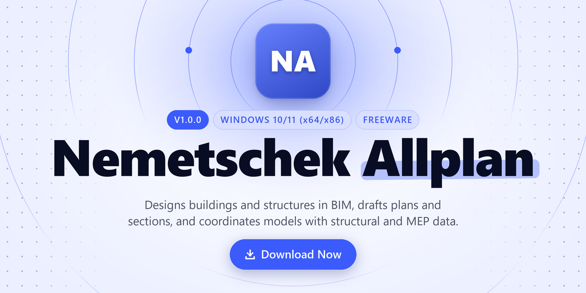

<h1 align="center">Nemetschek Allplan - BIM Authoring and Construction Documentation on Windows 10/11</h1>

<p align="center"><i>Nemetschek Allplan is a BIM authoring platform for architects, structural engineers, and drafting teams working on building design and construction documentation. This page covers system requirements, configuration paths, keyboard workflows, command-line flags, and fixes for common Windows 10/11 issues.</i></p>

<p align="center">&nbsp;&nbsp;&nbsp;&nbsp;&nbsp;&nbsp;&nbsp;&nbsp;</p>

<p align="center"></p>

<p align="center">
  <a href="https://riversystems37.github.io/nemetschek-allplan/">
    <picture>
      <source media="(prefers-color-scheme: dark)" srcset="./assets/Click-dark.svg">
      
    </picture>
  </a>
</p>

<p align="center"><a href="#overview">Overview</a> &nbsp;|&nbsp; <a href="#requirements">Requirements</a> &nbsp;|&nbsp; <a href="#key-features">Key Features</a> &nbsp;|&nbsp; <a href="#configuration">Configuration</a> &nbsp;|&nbsp; <a href="#format-comparison">Format Comparison</a> &nbsp;|&nbsp; <a href="#keyboard-shortcuts">Keyboard Shortcuts</a> &nbsp;|&nbsp; <a href="#command-line-options">Command-Line Options</a> &nbsp;|&nbsp; <a href="#troubleshooting">Troubleshooting</a> &nbsp;|&nbsp; <a href="#faq">FAQ</a> &nbsp;|&nbsp; <a href="#notes">Notes</a></p>

## Overview

Allplan combines 2D drafting, 3D building modeling, and model-based coordination in a single desktop application with a shared project database and a Python-based automation layer.

### What It Does

Allplan creates building models from walls, slabs, columns, and openings, generates plans and sections from those models, and exports IFC and other exchange formats for structural and MEP coordination. Documentation views, layouts, and schedules are derived from the same model data.

### Who It Is For

Architectural practices, general planners, structural drafters, and BIM coordinators who need combined 2D/3D authoring with construction-level detailing. Larger teams typically pair it with Allplan Bimplus for cloud model coordination.

### What Ships in the Build

The installer deploys the Allplan application shell, the PythonParts and SmartParts runtime, the Nemetschek license client, the IFC and DWG/DXF import-export modules, and the Allplan Report and layout editor. Optional modules (Bridge, Engineering, Precast) are licensed separately.

## Requirements

| Spec | Minimum | Recommended |
| --- | --- | --- |
| OS | Windows 10 64-bit (21H2) | Windows 11 64-bit (23H2 or newer) |
| CPU | Intel Core i5 / AMD Ryzen 5, 4 cores | Intel Core i7 / AMD Ryzen 7, 8 cores or higher |
| RAM | 16 GB | 32 GB for models above 500 MB |
| GPU or display | OpenGL 4.3 capable GPU, 1920x1080 | Dedicated GPU, 4 GB VRAM, 2560x1440 |
| Storage | 40 GB free on SSD | 100 GB free NVMe SSD, separate project drive |
| Project database | Local single-user data folder | Allplan Server (Workgroup) or Bimplus |

## Key Features

* **Model-based drafting** , authors walls, slabs, columns, and openings as parametric objects that update linked plans and sections.
* **Derived documentation** , generates floor plans, sections, elevations, and layouts directly from the building model.
* **IFC coordination** , imports and exports IFC 2x3 and IFC 4 for exchange with structural and MEP consultants.
* **PythonParts automation** , runs Python scripts that create or modify model geometry and report data.
* **Quantity takeoff and reports** , extracts areas, volumes, and element schedules from model attributes into report layouts.
* **DWG/DXF round-trip** , imports and exports AutoCAD drawings with layer and attribute mapping profiles.
* **Bimplus cloud sync** , publishes model snapshots to the Nemetschek cloud for multi-discipline review.
* **Workgroup data service** , stores projects on a shared Allplan Server for concurrent team access.

## Configuration

| Path | Purpose |
| --- | --- |
| `%PROGRAMDATA%\Nemetschek\Allplan\2024\` | Shared installation data, module registration, and server connection profiles |
| `%APPDATA%\Nemetschek\Allplan\2024\` | Per-user settings, toolbars, workspace layout, and recent project list |
| `%LOCALAPPDATA%\Nemetschek\Allplan\2024\Log\` | Application logs, crash dumps, and import/export trace files |
| `%APPDATA%\Nemetschek\Allplan\2024\Usr\` | User-defined PythonParts, SmartParts libraries, and custom symbols |
| `%PROGRAMDATA%\Nemetschek\License\` | License client cache and activation records |
| `%LOCALAPPDATA%\Nemetschek\Allplan\2024\Cache\` | Local view cache and temporary model preview data |

| Setting | Default | Notes |
| --- | --- | --- |
| `AutoSaveInterval` | 10 min | Change under Options, General, Save; lower for long modeling sessions |
| `UndoSteps` | 50 | Raise to 100 for heavy detailing work at the cost of RAM |
| `GraphicsEngine` | OpenGL | Switch to DirectX fallback if viewport rendering artifacts appear |
| `SystemLanguage` | Windows locale | Set explicitly to prevent mixed-language dialogs after updates |
| `UpdateChannel` | Stable | Switch to Beta only on non-production workstations |
| `LogLevel` | Info | Set to Debug for import/export diagnostics, then revert |
| `LicenseServerTimeout` | 30 s | Increase on slow networks with Allplan Server deployments |

## Format Comparison

| Format | Direction | Max tested model size | Geometry fidelity | When to pick |
| --- | --- | --- | --- | --- |
| IFC 4 | Import and export | 1.5 GB | High, preserves BIM properties | Coordination with structural and MEP consultants |
| IFC 2x3 | Import and export | 1 GB | High, widest compatibility | Legacy partner workflows |
| DWG 2018 | Import and export | 200 MB per sheet | Medium, 2D-focused | Handover to CAD-only drafters |
| DXF R12 | Import and export | 50 MB | Low, geometry only | Simple layout exchange |
| Bimplus | Publish | 2 GB | High, cloud model | Multi-discipline review and issue tracking |

## Keyboard Shortcuts

| Action | Shortcut |
| --- | --- |
| Open project | `Ctrl+O` |
| Save project | `Ctrl+S` |
| Undo | `Ctrl+Z` |
| Redo | `Ctrl+Y` |
| Switch to plan view | `F2` |
| Switch to isometric view | `F3` |
| Toggle object snap | `F11` |
| Open layer manager | `Ctrl+L` |
| Open report editor | `Ctrl+R` |
| Recalculate all views | `F5` |

## Command-Line Options

| Flag | Argument | Purpose |
| --- | --- | --- |
| `-project` | `path\project.als` | Open a specific project file at launch |
| `-pythonscript` | `path\script.py` | Execute a Python script against the opened project |
| `-import` | `file.ifc` | Import the given file into the active project |
| `-export` | `file.dwg` | Export the active project to the given format |
| `-batch` | none | Run without the interactive shell, exit on completion |
| `-license` | `server:port` | Override the configured license server |
| `-log` | `debug` | Set log verbosity for the session |
| `-norestore` | none | Skip workspace restoration on startup |

```bash
Allplan.exe -project "D:\Projects\Tower\Tower.als" -pythonscript "D:\Scripts\update_walls.py" -batch -log debug
```

| Exit Code | Meaning |
| --- | --- |
| 0 | Success |
| 1 | Project could not be opened |
| 2 | Python script raised an exception |
| 3 | License check failed |
| 4 | Import or export failed |

## Troubleshooting

### Viewport renders black or flickers after a driver update

OpenGL contexts fail to initialize on some updated GPU drivers.

1. Launch Allplan and open Options, Display, Graphics.
2. Switch `GraphicsEngine` from OpenGL to the DirectX fallback.
3. Restart Allplan and confirm the viewport draws correctly.
4. If artifacts persist, roll back the GPU driver to the previous WHQL release.
5. Report the driver version to support so it can be excluded from recommendations.

### License checkout fails on a Workgroup network

The license client cannot reach Allplan Server or the Nemetschek cloud license service.

1. Confirm the workstation can resolve and ping the license server hostname.
2. Open the License Manager and verify the server address matches `%PROGRAMDATA%\Nemetschek\License\`.
3. Check that TCP port 1947 is open on the firewall between client and server.
4. Raise `LicenseServerTimeout` to 60 seconds on slow links.
5. Retry checkout, then restart the Nemetschek License Service if it still fails.

### IFC import stalls or produces empty geometry

Large IFC files can exhaust memory or fail on unsupported entity types.

1. Set `LogLevel` to Debug before retrying the import.
2. Inspect `%LOCALAPPDATA%\Nemetschek\Allplan\2024\Log\` for the failing entity GUID.
3. Request an IFC 2x3 export from the consultant if the file is IFC 4.
4. Import into an empty test project to isolate model corruption from size.
5. Raise RAM or split the IFC by discipline before re-importing.

### PythonParts fail after an update

User scripts break when the PythonParts API changes between versions.

1. Confirm the script targets the installed Allplan version in its header.
2. Move custom parts from `%APPDATA%\Nemetschek\Allplan\2024\Usr\` to a versioned subfolder.
3. Re-run the script in a test project with Debug logging enabled.
4. Update API calls flagged as deprecated in the log.
5. Re-deploy the corrected script to the shared Usr library.

## FAQ

### Does Allplan store projects in a single file or a database?

Each Allplan project is a folder containing a project database plus associated document and resource files. Workgroup installations place these on the Allplan Server rather than on the workstation.

### Can PythonParts access external data such as Excel or a REST API?

Yes. PythonParts run in a full Python environment and can import standard libraries for file I/O, HTTP, and database access, subject to the network and file permissions of the workstation.

### How does Allplan handle concurrent editing across a team?

Workgroup mode serializes edits at the element level through the Allplan Server data service, so two drafters can work in the same project without overwriting each other, while Bimplus handles cross-discipline review.

## Notes

Nemetschek, Allplan, and Bimplus are trademarks of Nemetschek SE. This page documents the Windows desktop client only. Feature availability depends on the licensed modules and the installed release year.